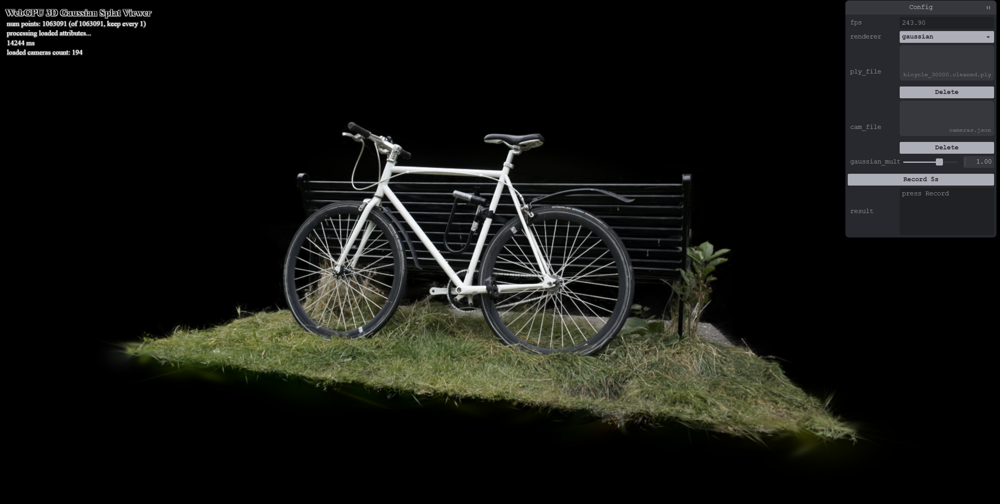
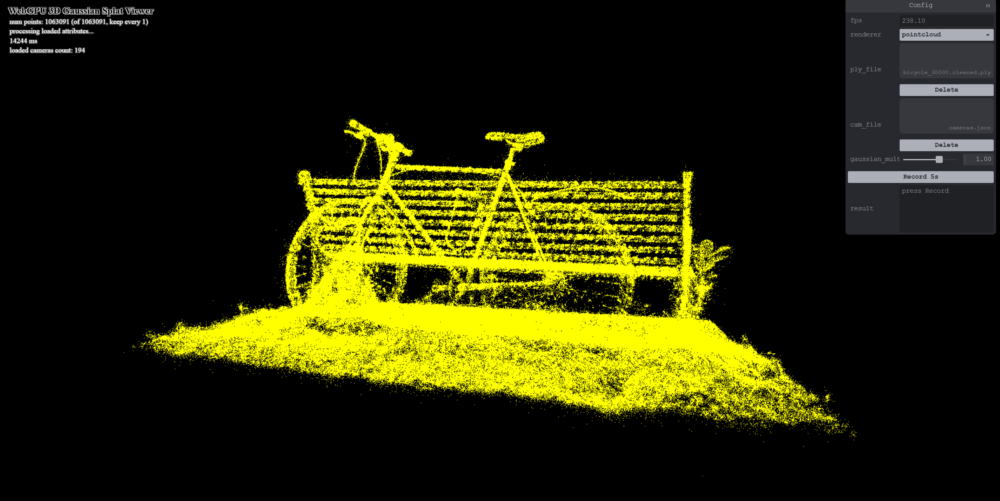
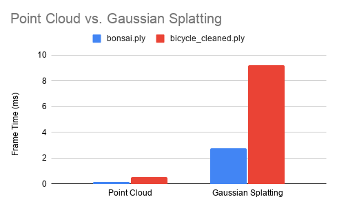
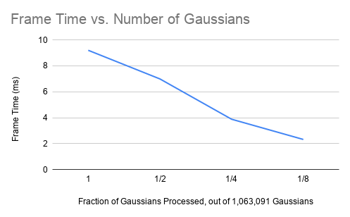

# WebGPU-Gaussian-Splat-Viewer

**University of Pennsylvania, CIS 565: GPU Programming and Architecture, Project 5**

* Rin Fukuoka
* Tested on: Windows 11, i9-13900HX @ 2.20 GHz, 32GB RAM, RTX 4080 Laptop GPU 12GB

https://github.com/user-attachments/assets/7ea62cd3-b155-4c36-937e-17b7731a4c58

This video is compressed. For better results, see the live demo and load a Gaussian scene.
### [Live Demo Here](https://rf1424.github.io/WebGPU-Gaussian-Splat-Viewer/)

This project is a real-time viewer for 3D Gaussian Splatting scenes, built with WebGPU. Each scene is made of millions of small, soft, colored 3D blobs (Gaussians) that together recreate a physical scene from image data. 

Starting from pretrained scenes, I built the pipeline to render these Gaussians in the browser in real time. I first implemented a simple point cloud renderer that draws the center of each Gaussian as a dot, then a full Gaussian renderer that draws each one as a soft, oriented splat. Each frame of the Gaussian renderer runs in three stages. 

In the **preprocess pass**, a compute shader runs once per Gaussian. It performs view frustum culling to discard Gaussians outside the camera's view, builds each remaining Gaussian's 3D covariance from its rotation and scale, and projects it to a 2D covariance on screen. From that it derives the conic, the splat's radius and quad size, and its view-dependent color from spherical harmonics. The results are written to a splat buffer, along with a depth key and index for sorting.

In the **sorting pass**, a GPU radix sort, made of several compute passes, orders the visible Gaussians by depth so they can be drawn back to front.

In the **rendering pass**, each visible Gaussian is drawn as an instanced quad using an indirect draw call. The fragment shader uses the conic to fade opacity exponentially away from the splat center, and the splats are alpha-blended back to front into a smooth, photo-like image.

## Performance Analysis

All numbers are frame times in milliseconds, averaged over 5 seconds at 1920×1080 resolution.

#### Point Cloud vs. Gaussian Renderer

Gaussian splatting is about 17–18× slower in both scenes. The point cloud draws one pixel per Gaussian. The Gaussian renderer computes each Gaussian's shape and color, sorts them by depth, and draws a blended quad of many pixels for each. The bicycle scene is slower in both because it has more Gaussians.

#### Workgroup Size

Frame time (ms) by preprocess workgroup size:

| Workgroup Size (threads) | bicycle_cleaned.ply (ms) | bonsai.ply (ms) |
|---:|---:|---:|
| 256 | 9.24 | 2.78 |
| 128 | 9.11 | 3.20 |
| 64  | 9.20 | 2.75 |
| 32  | 8.80 | 2.95 |

Workgroup size has almost no effect. Each thread handles its own Gaussian independently, so grouping matters little.

#### Number of Gaussians

Bicycle scene (1,063,091 Gaussians total).

Frame time drops steadily with fewer Gaussians: 1/8 of them is about 4× faster. It's not exactly proportional, because some costs are fixed (pass setup, screen clear, the sort's fixed steps), and fewer Gaussians also means less overlap per pixel. 

#### Culling vs. No Culling

Frame time (ms) with and without view frustum culling:

| Frustum Culling | bicycle_cleaned.ply (ms) | bonsai.ply (ms) |
|---|---:|---:|
| On  | 9.20 | 2.90 |
| Off | 9.17 | 3.00 |

Culling made no real difference. While I tested with object scenes here, culling should help more when the camera is inside/zoomed in on an environment and most Gaussians are out of view. 

### Credits

- [Vite](https://vitejs.dev/)
- [tweakpane](https://tweakpane.github.io/docs//v3/monitor-bindings/)
- [stats.js](https://github.com/mrdoob/stats.js)
- [wgpu-matrix](https://github.com/greggman/wgpu-matrix)
- Special Thanks to: Shrek Shao (Google WebGPU team) & [Differential Guassian Renderer](https://github.com/graphdeco-inria/diff-gaussian-rasterization)
